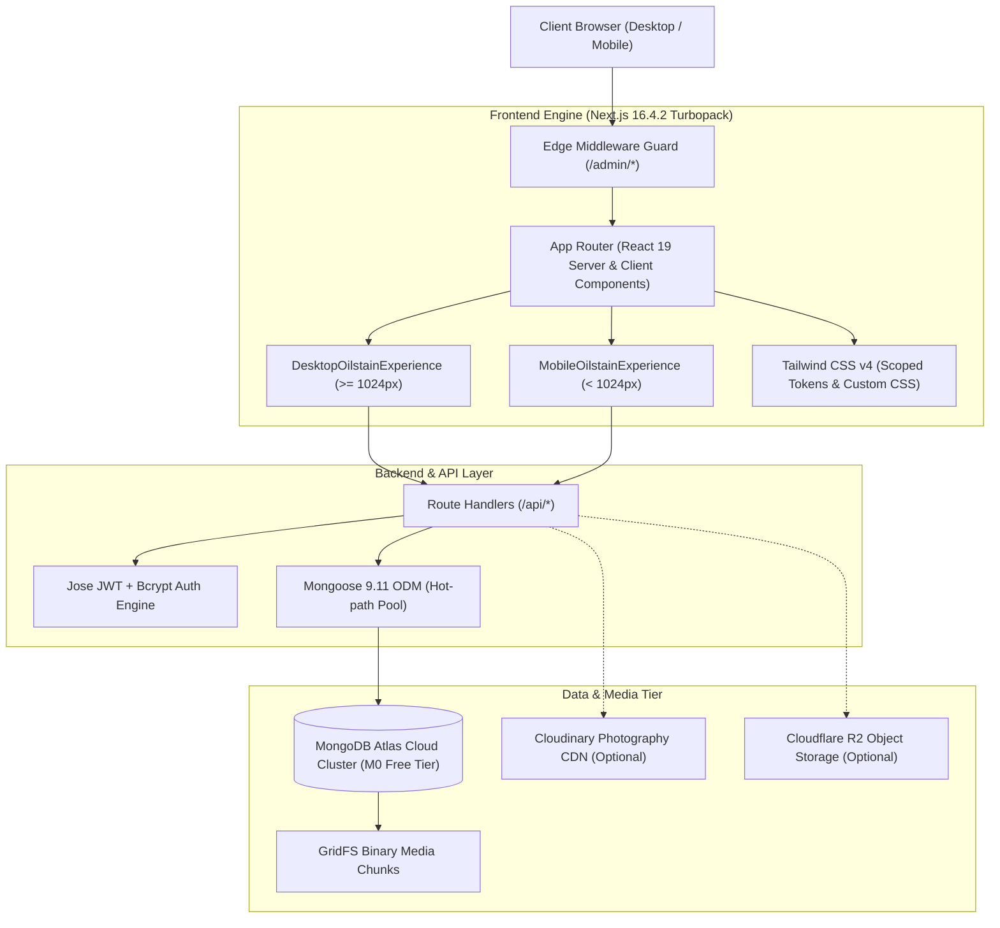

<div align="center">


<br /><br />

[](https://shutterscape-seven.vercel.app)
[](https://nextjs.org/)
[](https://react.dev/)
[](https://www.typescriptlang.org/)
[](https://tailwindcss.com/)
[](https://www.mongodb.com/atlas)
[](https://turbo.build/)

<p align="center">
  <a href="#-live-deployment">Live Demo</a> •
  <a href="#-overview">Overview</a> •
  <a href="#-dual-engine-responsive-architecture">Dual-Engine Architecture</a> •
  <a href="#-enterprise-darkroom-cms">Darkroom CMS</a> •
  <a href="#-tech-stack">Tech Stack</a> •
  <a href="#-getting-started">Installation & Setup</a> •
  <a href="#-api-endpoints">REST API</a> •
  <a href="#-repository-structure">Repository Structure</a> •
  <a href="#-club-leadership">Leadership</a>
</p>

---

</div>

<br />

## 🌐 Live Deployment

| Environment | Production URL | Status | Platform |
| :--- | :--- | :--- | :--- |
| **Production** | [https://shutterscape-seven.vercel.app](https://shutterscape-seven.vercel.app) | `HTTP/2 200 OK` | Vercel Edge Network |
| **Admin CMS** | [https://shutterscape-seven.vercel.app/admin/dashboard](https://shutterscape-seven.vercel.app/admin/dashboard) | Secured (JWT) | Next.js Edge Auth |
| **Admin Login** | [https://shutterscape-seven.vercel.app/admin/login](https://shutterscape-seven.vercel.app/admin/login) | Public Gateway | Bcrypt + Jose JWT |

---

## 🌟 Overview

**ShutterScape** is the official digital archive and visual documentation platform of **Girijananda Chowdhury University (GCU)** in Assam, India. Blending tactile analog darkroom aesthetics with modern web performance, ShutterScape serves as both an immersive public exhibition of student photography and an enterprise-grade content management system (CMS).

From high-speed Xenon flash choreography and 35mm silver-gelatin film contact sheets to golden-hour Brahmaputra expeditions, ShutterScape archives student stories across 6 distinct photography disciplines: **Documentary, Portraiture, Landscape, Architecture, Street, and Motion Reels**.

---

## ⚡ Dual-Engine Responsive Architecture

ShutterScape features an intelligent **Responsive Twin-Engine** at its root (`src/app/page.tsx`), serving dedicated, zero-compromise experiences tailored specifically for desktop monitors and mobile touchscreens:

```
                                  [ User Request ]
                                         │
                                ┌────────┴────────┐
                        Viewport Width >= 1024px?
                                │                 │
                             [ YES ]           [ NO ]
                                │                 │
                    DesktopOilstainExperience  MobileOilstainExperience
                    (Widescreen Editorial)     (Touch-First Responsive)
```

### 🖥️ Desktop Experience (`>= 1024px`)
- **3D Concave Cylindrical Ribbon**: 6-slice mathematical perspective arc with real-time mouse scrub and auto-spin showcasing archival exhibition plates.
- **Darkroom Curator’s Light Table Desk**:
  - *Left*: Layered dual-Polaroid prints with subtle `-6°` and `+4.5°` physical skew and `PLATE 01A` badges.
  - *Center*: Archival fountain-pen handwritten manifesto on textured archival paper with washi-tape and red `GCU ARCHIVE 2026 35MM` stamp.
  - *Right*: Warm Ivory Matted Exhibition Print Card with EXIF telemetry (`85MM · F/1.4 · KODAK PORTRA`).
- **Spotlight ’26 Collector's Pass**: Live 1-second countdown clock for upcoming photowalks and live on-campus workshops, paired with a 3-pillar highlight strip.
- **Frameless 12-Slot Half-Wheel Fan**: Continuous sine-squared smooth card fan floating directly on the `#ECEBE6` canvas with zero clipping.
- **Standardized 235px Studio Portraits**: Centered 6-chapter leadership roster across Founders, Faculty Mentors, and Student Storytellers.
- **5-Card 3D Motion Reel Carousel**: Ambient simultaneous muted video playback with active center audio toggle and zero-re-render progress tracking.
- **Embedded Interactive Campus Map**: Live Google Maps view centered on Girijananda Chowdhury University (Azara, Guwahati).
- **Proportioned Desktop Navbars**: Slim 46px floating glass top capsule (`LIVE REC // 35MM GCU ARCHIVE`) + 460px × 52px floating notch dock.

### 📱 Mobile Experience (`< 1024px`)
- **Touch-Optimized Navigation**: Compact floating notch dock with smooth SVG path morphing and active bubble animation.
- **Instant First-Frame Video Decoding (`#t=0.001`)**: Eliminates the black-rectangle freeze on iOS Safari by seeking immediately to frame 0.001 upon metadata load.
- **Zero Re-Render Video Engine**: Direct DOM ref updates (`progressBarRefs.current[index].style.width = ...`) replace state updates, preventing component re-rendering 10 times/second and maintaining 60fps playback.
- **Network-Prioritized Streaming**: Active video utilizes `preload="auto"` while background cards use `preload="metadata"`, preventing cellular bandwidth saturation.
- **Darkroom Shimmer Fallbacks**: Custom pulse loader placeholders prevent blank voids during network latency.
- **Uncluttered Mobile Footer**: Cleanly separated brand crests and official SVG Instagram & WhatsApp action pills with generous dock clearance (`padding-bottom: 148px`).

---

## 🎛️ Enterprise Darkroom CMS

ShutterScape includes an **isolated, administrative Content Management System** inspired by SaaS design systems (WrapPixel, Linear).

```
+-------------------------------------------------------------------------------+
|  SHUTTERSCAPE CMS                                [ Sync ] [ + Add New Frame ] |
|  ---------------------------------------------------------------------------  |
|  [KPIs]  25 Archive Frames | 24 Timeline Events | 17 Members | 20 Scene Reels |
|  ---------------------------------------------------------------------------  |
|  [Search 🔍]  [ All Categories ] [ Documentary ] [ Portraiture ] [ Street ]   |
|                                                                               |
|  +--------------------+ +--------------------+ +--------------------+         |
|  | [16:10 Thumbnail]  | | [16:10 Thumbnail]  | | [16:10 Thumbnail]  |         |
|  | Monsoon Over Brah. | | Chiaroscuro Gaze   | | Himalayan Alpeng.  |         |
|  | By Riky            | | By Pratyashi P.    | | By Akash Boro      |         |
|  | KODAK 400TX        | | PORTRA 800         | | VELVIA 50          |         |
|  | [ Edit ] [ Trash ] | | [ Edit ] [ Trash ] | | [ Edit ] [ Trash ] |         |
|  +--------------------+ +--------------------+ +--------------------+         |
+-------------------------------------------------------------------------------+
```

### CMS Highlights
- **JWT Edge Authentication**: Secure, salted bcrypt passwords with edge cookie session verification (`jose`).
- **Comprehensive Entity Management**: Full CRUD operations across Gallery Frames, Activity Events, Committee Members, Moments Reels, and Spotlight Features.
- **Hybrid Multi-Cloud Storage**:
  - **MongoDB GridFS / Binary Streams**: Self-contained media streaming (`/api/media/[id]`) with HTTP 206 Partial Content Range support.
  - **Cloudinary Integration**: Automatic image optimization and global CDN delivery.
  - **Cloudflare R2 (S3-Compatible)**: High-speed presigned URL uploads with zero egress fees.

---

## 🏗️ Tech Stack



| Layer | Technology | Version | Purpose |
| :--- | :--- | :--- | :--- |
| **Framework** | Next.js (App Router, Turbopack) | `16.4.2` | Core SSR/SSG/ISR framework and routing |
| **UI Library** | React | `19.3.0` | Declarative component architecture |
| **Language** | TypeScript | `5.x` | Strict end-to-end type safety |
| **Styling** | Tailwind CSS | `v4.3.3` | Modern utility styling and CSS custom properties |
| **Database** | MongoDB Atlas | Cloud M0 | Document database & GridFS binary storage |
| **ODM** | Mongoose | `9.11.4` | Object data modeling and connection pooling |
| **Authentication** | Jose & BcryptJS | `6.2.13` / `3.0.3` | JWT edge signing, verification, and password hashing |
| **Cloud Storage** | Cloudinary / AWS S3 SDK | `2.11.0` / `3.1160.0` | Flexible multi-provider media pipelines |
| **Animation** | GSAP & Three.js | `3.15.0` / `0.186.1` | WebGL optics rendering and scroll physics |

---

## 🚀 Getting Started

### Prerequisites
- **Node.js** `20.x` or higher
- **npm**, **pnpm**, or **yarn**
- A **MongoDB Atlas** database connection string (free tier available at [mongodb.com/atlas](https://www.mongodb.com/atlas))

### 1. Clone the Repository
```bash
git clone https://github.com/coding-club-gcu/shutterscape.git
cd shutterscape
```

### 2. Install Dependencies
```bash
npm install
```

### 3. Configure Environment Variables
Copy the template configuration file:
```bash
cp .env.example .env.local
```

Edit `.env.local` with your configuration:
```env
# MongoDB Atlas Connection String
MONGODB_URI=mongodb+srv://<username>:<password>@cluster0.abcde.mongodb.net/shutterscape?retryWrites=true&w=majority

# JWT Secret Key (Any random 32+ character string)
AUTH_SECRET=shutterscape-super-secure-darkroom-vault-secret-key-2026

# Initial Emergency Admin Credentials
ADMIN_INIT_USERNAME=admin
ADMIN_INIT_PASSWORD=ShutterScape2026!

# Optional: Cloudinary Storage (Free 25GB/mo)
CLOUDINARY_CLOUD_NAME=
CLOUDINARY_API_KEY=
CLOUDINARY_API_SECRET=

# Optional: Cloudflare R2 Storage (Free 10GB)
CLOUDFLARE_ACCOUNT_ID=
R2_ACCESS_KEY_ID=
R2_SECRET_ACCESS_KEY=
R2_BUCKET_NAME=shutterscape-media
R2_PUBLIC_URL=
```

### 4. Seed the Database
Populate the database with all 25 curated visual archive plates, 24 timeline events, 17 committee members, and 5 video reels:
```bash
npm run seed-db
```

To provision or reset an administrative user:
```bash
npm run create-admin
```

### 5. Run Development Server
```bash
npm run dev
```

Open [http://localhost:3000](http://localhost:3000) in your browser.  
To access the CMS, navigate to [http://localhost:3000/admin/dashboard](http://localhost:3000/admin/dashboard).

### 6. Production Build & Verification
```bash
npm run build
npm run start
```

---

## 📡 REST API Reference

All API routes are located in `src/app/api/` and return standardized JSON responses `{ success: boolean, data: any }`:

| Method | Endpoint | Description | Auth Required |
| :--- | :--- | :--- | :--- |
| `GET`, `POST` | `/api/gallery` | Retrieve or create archival exhibition frames | POST: Yes |
| `GET`, `POST` | `/api/activities` | Retrieve or create photowalks, workshops & exhibitions | POST: Yes |
| `GET`, `POST` | `/api/committee` | Retrieve or manage leadership roster members | POST: Yes |
| `GET`, `POST` | `/api/moments-reels` | Retrieve or create vertical cinema motion reels | POST: Yes |
| `GET`, `POST` | `/api/spotlight` | Retrieve or update Upcoming/Live expedition dispatch | POST: Yes |
| `GET` | `/api/media/[id]` | Stream binary MP4 video / images with HTTP 206 Range support | No |
| `POST` | `/api/auth` | JWT session validation and administrator login | No |
| `POST` | `/api/upload` | Multipart file upload to GridFS / Cloudinary / R2 | Yes |
| `POST` | `/api/upload/presign` | Generate S3/R2 direct upload presigned URL | Yes |
| `POST` | `/api/upload/cloudinary-sign` | Generate Cloudinary cryptographic upload signature | Yes |

---

## 📁 Repository Structure

```
shutterscape/
├── public/
│   ├── audio/               # Darkroom ambient audio assets
│   ├── images/              # University branding, logos & film assets
│   │   ├── gcu-logo-black-text.png
│   │   ├── gcu-logo-white-text.png
│   │   ├── shutterscape-brand-white.png
│   │   └── shutterscape-logo-cropped.png
│   └── videos/              # Video reel files (MP4 format)
├── scripts/
│   ├── create-admin.ts      # Administrative user provisioning script
│   └── seed-database.ts     # 1-click cloud database population script
├── src/
│   ├── app/
│   │   ├── about/           # Dedicated about page
│   │   ├── activities/      # Dedicated club activities directory
│   │   ├── admin/           # Administrative portal
│   │   │   ├── dashboard/   # Unified Darkroom CMS
│   │   │   └── login/       # Administrative JWT login screen
│   │   ├── api/             # RESTful API route handlers
│   │   ├── gallery/         # Dedicated 25-frame visual archive page
│   │   ├── globals.css      # Custom design tokens, reset & animations
│   │   ├── layout.tsx       # Root layout with Google Fonts
│   │   ├── not-found.tsx    # Branded 404 error page
│   │   ├── page.tsx         # Dual-engine responsive entry point
│   │   ├── robots.ts        # Dynamic robots.txt generation
│   │   └── sitemap.ts       # Dynamic XML sitemap generator
│   ├── components/
│   │   ├── admin/           # CMS UI components (FileUploadZone, etc.)
│   │   ├── cinematic/       # Legacy 3D WebGL Three.js & GSAP components
│   │   ├── desktop/         # Widescreen Desktop Experience (>= 1024px)
│   │   │   └── DesktopOilstainExperience.tsx
│   │   └── mobile/          # Responsive Mobile Experience (< 1024px)
│   │       └── MobileOilstainExperience.tsx
│   ├── config/              # Mobile hero video & poster config
│   ├── data/                # Static fallback datasets
│   ├── lib/
│   │   ├── auth.ts          # Jose JWT generation, verification & bcrypt
│   │   ├── cloudinary.ts    # Cloudinary SDK wrapper
│   │   ├── db.ts            # Mongoose singleton connection pool
│   │   ├── r2.ts            # Cloudflare R2 S3 client wrapper
│   │   └── utils.ts         # Utility class merging functions
│   ├── middleware.ts        # Next.js edge route protection guard
│   └── models/              # Mongoose database schemas
│       ├── ActivityEvent.ts
│       ├── AdminUser.ts
│       ├── CommitteeMember.ts
│       ├── GalleryFrame.ts
│       ├── HeroReel.ts
│       ├── MomentsReel.ts
│       ├── PullInExhibit.ts
│       ├── Spotlight.ts
│       └── UploadMedia.ts
├── .env.example             # Documented template environment configuration
├── .gitignore               # Strict git ignore definitions
├── eslint.config.mjs        # ESLint configuration
├── next.config.ts           # Next.js compiler & domain configuration
├── package.json             # NPM dependencies and runner scripts
├── tailwind.config.ts       # Tailwind CSS v4 setup
└── tsconfig.json            # TypeScript compiler configuration
```

---

## 👥 Club Leadership (GCU ShutterScape)

| Tier | Role | Name | Department / Focus |
| :--- | :--- | :--- | :--- |
| **Faculty Mentorship** | Coordinator | **Dr. Sangeeta Das** | Dept. of Mechanical Engineering |
| **Faculty Mentorship** | Co-Coordinator | **Dr. Barsha Chhetri** | Dept. of Education |
| **Executive Leadership** | President | **Uttama Purkayastha** | Executive Board · Creative Direction |
| **Executive Leadership** | Vice-President | **Ikhyt De Neog** | Operations & Field Expeditions |
| **Executive Leadership** | Secretary | **Richita Sarma** | Editorial & Archive Administration |
| **Core Division** | Core Member | **Sohaib Hussain** | Street Documentary & Action |
| **Core Division** | Core Member | **Mahadananda Dutta** | Optics & Strobe Choreography |
| **Core Division** | Core Member | **Manash Pratim Sarma** | Landscape & Himalayan Expeditions |
| **Core Division** | Core Member | **Mubina Ahmed** | Print Design & Exhibition Curation |
| **Core Division** | Core Member | **Pratyush B. Choudhury** | Motion Reels & Cinematography |
| **Core Division** | Core Member | **Hiya Das** | Architecture & Spatial Studies |
| **Founders Council** | Co-Founder (2023) | **Dheemaan Deka** | Founding Visionary |
| **Founders Council** | Co-Founder (2023) | **Subhrajyoti Goswami** | Founding Architect |
| **Alumni Legacy** | Legacy Torchbearer | **Gargi Medhi** | Portraiture Symposia |
| **Alumni Legacy** | Legacy Torchbearer | **Imran Farhat** | Nocturnal & Low-Light Archives |

---

## 📄 License & Attribution

```
Copyright (c) 2026 ShutterScape — Girijananda Chowdhury University (GCU), Assam.
All photographic plates, film scans, and media assets belong to their respective student photographers.
```

- **Crafted with pride by**: [Krishnayan](https://github.com/krishnayankashyap-hub)  
- **Technical Division**: [Codénix (GCU)](https://codingclub.gcuniversity.ac.in)  
- **University**: [Girijananda Chowdhury University](https://gcu.ac.in) (Hathkhowapara, Azara, Guwahati, Assam 781017)

<div align="center">
  <sub>Observe. Capture. Tell Stories Through Light.</sub>
</div>
